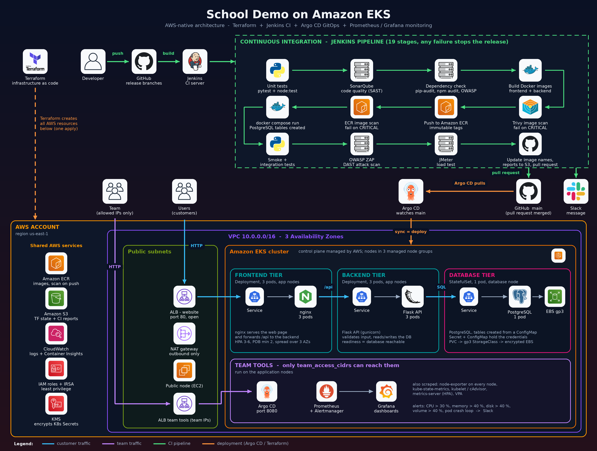

# School Demo on Amazon EKS

## AWS-native architecture



*(Click the picture to open it full size.)*

The whole platform runs on AWS and is built with Terraform. Jenkins builds, tests and scans the code, Amazon ECR
stores the images, and Argo CD deploys them to Amazon EKS. Customers reach the site through an Application Load
Balancer; the team reaches its tools (Argo CD, Prometheus, Grafana) through a second load balancer that only accepts
the team's IP addresses.

**How to read the picture**

| Part | What it shows |
|---|---|
| Top left | Terraform creates all the AWS resources in one apply. A developer pushes code to GitHub and Jenkins builds the release branch |
| Green dashed box | the 19-stage Jenkins pipeline: tests, SonarQube, dependency checks, image build, Trivy and ECR scans, a full test run with docker compose, ZAP and JMeter, then a pull request into `main` |
| Orange arrows | deployment: when the pull request is merged into `main`, Argo CD pulls the change and syncs it to the cluster with a rolling update (no downtime) |
| AWS account box | the VPC across 3 Availability Zones with public subnets (load balancers, NAT gateway), the EKS cluster with the frontend, backend and database tiers, and the shared services (ECR, S3, CloudWatch, IAM, KMS) |
| Blue arrows | customer traffic: Users, Application Load Balancer, nginx frontend, Flask backend, PostgreSQL on an encrypted EBS volume |
| Purple arrows | team traffic: only the allowed IPs reach Argo CD, Prometheus and Grafana through a separate load balancer |

Rolling back is one revert: revert the release commit on `main` and Argo CD deploys the previous version again.

### AWS services used and why

| AWS service | What it does here |
|---|---|
| **VPC**, subnets, Internet Gateway, NAT Gateway, route tables | the private network: public, private and database subnets in 3 Availability Zones |
| **Security groups** | firewalls: database port 5432 only from the application subnets, team tools only from team IPs |
| **Amazon EKS** | managed Kubernetes control plane; 5 managed nodes in 3 node groups (public, application, database) |
| **EC2** (managed node groups) | the servers that run the containers, with encrypted disks and IMDSv2 |
| **Elastic Load Balancing (ALB)** | one public ALB for customers, one restricted ALB for the team's tools |
| **Amazon ECR** | private image registry with immutable tags and vulnerability scanning on push |
| **Amazon EBS (gp3)** | encrypted disk for the PostgreSQL data, created automatically by the EBS CSI driver |
| **IAM** (roles, IRSA, EKS access entries) | least-privilege permissions for the cluster, the nodes, each add-on and each person |
| **AWS KMS** | encrypts Kubernetes Secrets in the cluster |
| **Amazon S3** | Terraform state and the CI reports (separate folders) |
| **Amazon CloudWatch** | control-plane logs and Container Insights |
| **AWS Systems Manager** | shell access to nodes without SSH keys |

Outside AWS: **GitHub** (code and pull requests), **Jenkins** and **SonarQube** (CI server), **Argo CD** (CD),
**Prometheus, Alertmanager and Grafana** (monitoring), **Slack** (notifications).

---

## What this project is

A small school portal (register a student, look up a student's hall ticket and marks) used to learn and demonstrate a
complete production-style delivery chain: infrastructure as code, CI with security scanning, GitOps deployment with
zero-downtime updates and rollback, and monitoring with alerts.

Three tiers:

| Tier | Technology | Runs on |
|---|---|---|
| Frontend | nginx serving HTML, CSS and JavaScript | application nodes |
| Backend | Python Flask API (gunicorn) | application nodes |
| Database | PostgreSQL, one pod with a persistent volume | database node |

## Documentation (start here)

| # | Document | Read it to learn |
|---|---|---|
| 1 | [First deployment](docs/01-first-deployment.md) | every step from clone to a running site, Jenkins setup, deploy version 1 then version 2, rollback |
| 2 | [Infrastructure](docs/02-infrastructure.md) | what each Terraform part builds, why, and which IAM permissions it has |
| 3 | [Application](docs/03-application.md) | the frontend, backend and database, and the tests |
| 4 | [Kubernetes files](docs/04-kubernetes.md) | every manifest line by line, plus the commands to inspect pods, logs and networking |
| 5 | [Jenkins pipeline](docs/05-jenkins-pipeline.md) | every pipeline stage and how to troubleshoot it |
| 6 | [Monitoring](docs/06-monitoring.md) | metrics, Grafana dashboards, alerts and Slack |

## Quick start

```bash
git clone https://github.com/Manojsiriparthi/kubernetes-project.git && cd kubernetes-project
sudo ./scripts/pre-tools.sh          # install tools, Jenkins, SonarQube, scanners
# create infra/terraform.tfvars with your IPs (see docs/01-first-deployment.md, Step 3)
./scripts/infra.sh                   # enter 1 to create everything, 2 to destroy everything
kubectl apply -f argocd/application.yaml
```

Then set up Jenkins and run the pipeline as described in [docs/01-first-deployment.md](docs/01-first-deployment.md).

## Repository layout

```
infra/          Terraform: networking, EKS cluster, node groups, add-ons
kubernetes/     manifests deployed by Argo CD
application/    frontend and backend source code and Dockerfiles
tests/          smoke, integration and JMeter load tests
jenkins/        Jenkinsfile.groovy and its helper scripts
argocd/         the Argo CD Application (repository URL, branch, folder)
scripts/        pre-tools.sh (install tools) and infra.sh (create or destroy)
docs/           the step-by-step guides; docs/images/ holds the architecture picture
docker-compose.yml   run the whole app on one machine
```

The architecture picture is drawn by `docs/images/draw_architecture.py`; the first lines of that file explain how to
regenerate it.

## Branches

| Branch | Purpose |
|---|---|
| `main` | what Argo CD deploys; changes arrive only through pull requests raised by Jenkins |
| `release/version1` | release 1 of the application (original look) |
| `release/version2` | release 2 (new look), used to demonstrate an update and a rollback |

## Cost warning

EKS, five servers, a NAT gateway and two load balancers cost real money while they run. When you finish practising,
run `./scripts/infra.sh` and enter `2` to remove everything.
